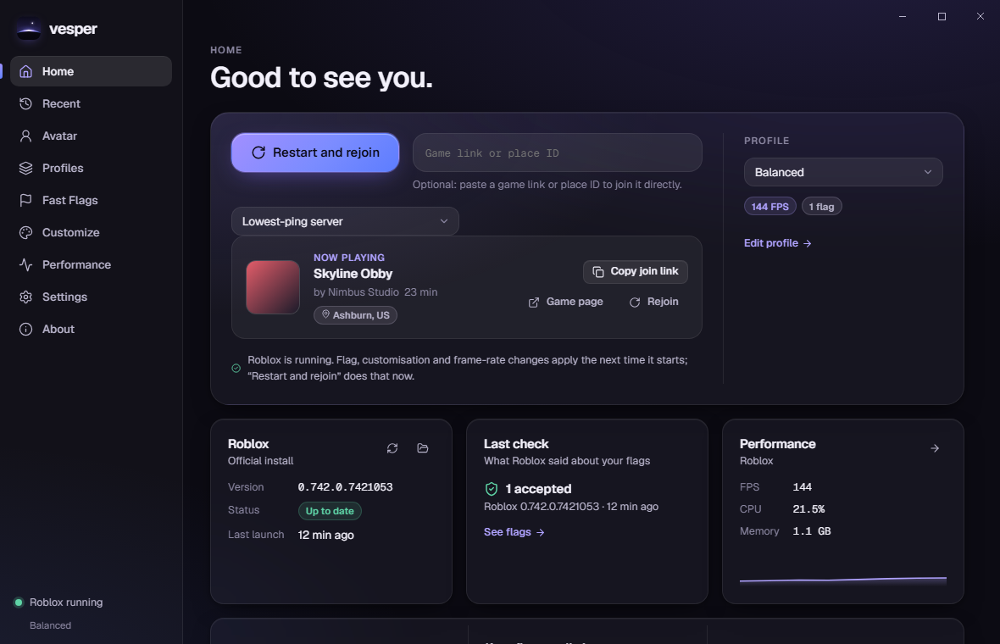
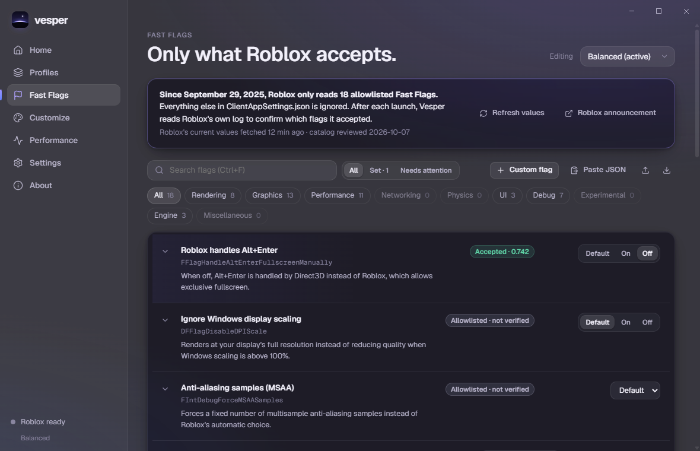
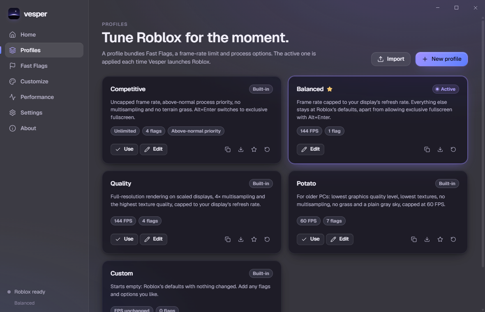
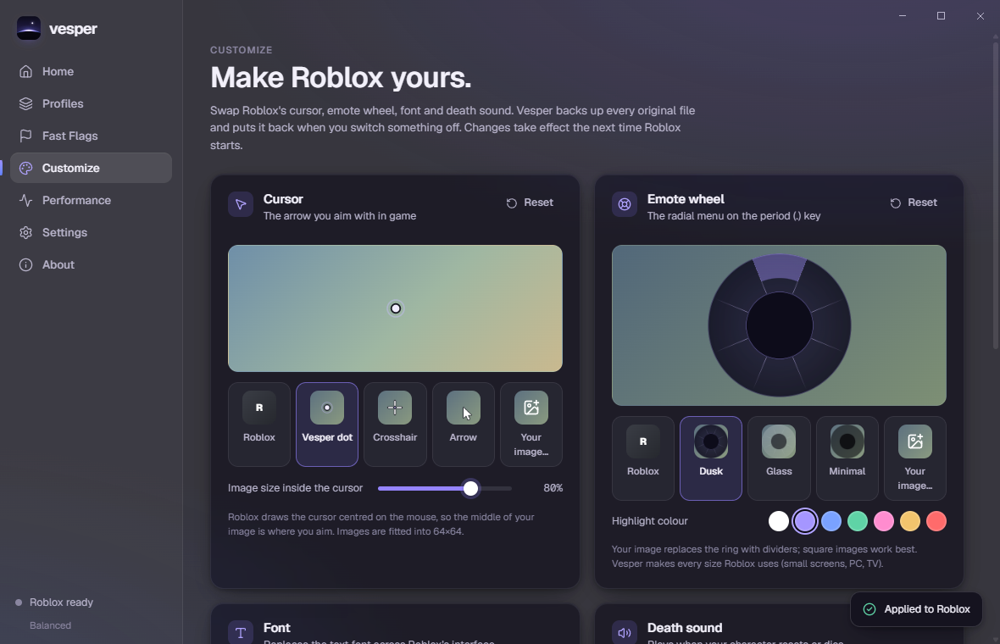
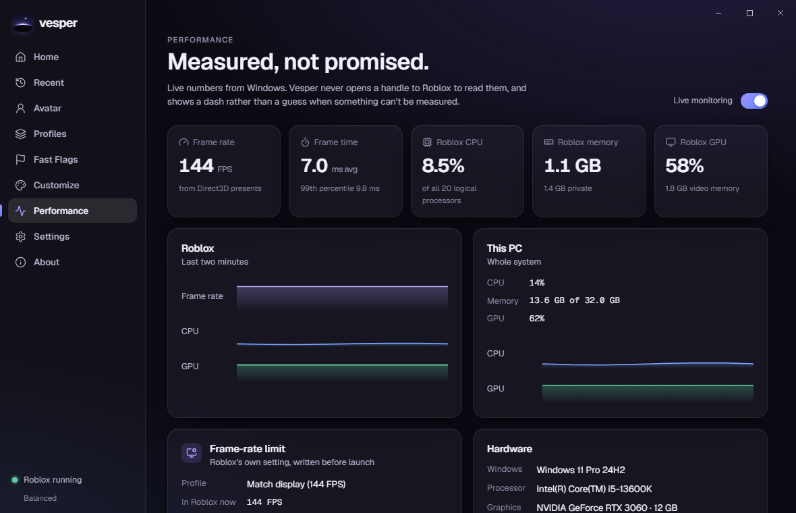

<p align="center">
  <picture>
    <source media="(prefers-color-scheme: dark)" srcset="assets/branding/wordmark.svg">
    
  </picture>
</p>

<p align="center"><strong>Roblox, tuned and verified.</strong><br>
A fast, private Roblox launcher for Windows and macOS.</p>

<p align="center">
  <a href="https://xan.gripe/vesper">Website</a> ·
  <a href="https://xan.gripe/vesper#download">Download</a> ·
  <a href="CHANGELOG.md">Changelog</a> ·
  <a href="SECURITY.md">Security</a>
</p>

<p align="center"></p>

---

## Why Vesper

In September 2025 Roblox started ignoring every local Fast Flag that isn't on
its [published allowlist](https://devforum.roblox.com/t/allowlist-for-local-client-configuration-via-fast-flags/3966569).
Most "FPS boost" flag lists stopped doing anything overnight, and launchers
kept showing them anyway.

Vesper only offers what Roblox still accepts, and then **checks**: after every
launch it reads Roblox's own log, which records each flag it loaded and each
one it denied, and shows you the result per flag and per Roblox version.

It never promises frame rates. It shows what it measured, and a dash when it
can't measure something.

## Features

- **Launch** the Roblox app, or join a game from a place ID, game link,
  private-server link or `roblox://` link. Vesper follows Roblox through its
  own self-updates and tells you, in plain language, if Roblox closes or never
  opens.
- **Fast Flags** for all 18 allowlisted flags, explained in plain language,
  with risk, confidence in the described behaviour, sources, and Roblox's
  published values. Conflicts (two graphics APIs at once, a texture level
  without its override) are caught and fixed in one click.
- **Verification** from Roblox's log after each launch: accepted, denied or
  not read, with the Roblox version it was checked on.
- **Profiles**: Competitive, Balanced, Quality, Potato and Custom, plus your
  own. Duplicate, rename, export, import (including old `ClientAppSettings.json`
  files, with ignored flags pointed out), reset and set a default.
- **Frame-rate limit** using Roblox's own setting: 30, 60, 75, 120, 144, 165,
  240, 360, 480, unlimited, custom, or your display's refresh rate.
- **Customize** Roblox's cursor and emote wheel (built-in styles or your own
  image, generated at every size Roblox uses, with a highlight colour), its
  font and death sound, or any other file. Originals are backed up and put back.
- **Performance**: Roblox's and your PC's CPU, memory and GPU use, plus frame
  rate and frame timing from Direct3D present events where Windows allows it.
- **Discord Rich Presence**, built in: "Using Vesper" with a *Get Vesper* button.
- **Backups and recovery**, diagnostics you can paste into a bug report, a
  system tray icon, start with Windows, and signed updates.

<table>
  <tr>
    <td></td>
    <td></td>
  </tr>
  <tr>
    <td></td>
    <td></td>
  </tr>
</table>

## Installation

1. Download the installer from **[xan.gripe/vesper](https://xan.gripe/vesper#download)**.
2. Run `Vesper_x.y.z_x64-setup.exe`. It installs for your Windows account
   only (no administrator rights) and adds Start menu and desktop shortcuts.
3. Vesper finds Roblox automatically. If Roblox isn't installed, install it
   from [roblox.com](https://www.roblox.com/download) and open it once.

Requirements: Windows 10 or 11 (64-bit) with Microsoft Edge WebView2, which
Windows 11 includes and the installer adds on Windows 10 if needed.

### macOS

1. Download `Vesper_x.y.z_universal.dmg`, open it and drag Vesper to
   Applications. It runs on macOS 11 or later, on Apple silicon and Intel.
2. The first time, macOS says it can't check Vesper for malicious software
   (Vesper isn't notarized by Apple yet). Open **System Settings → Privacy &
   Security** and choose **Open Anyway**.
3. Vesper finds `Roblox.app` in Applications. If macOS says it blocked Vesper
   from changing Roblox, turn Vesper on under **System Settings → Privacy &
   Security → App Management**, so it can write Fast Flags into Roblox.app.

On macOS, Vesper lives in the menu bar while its window is closed. macOS
doesn't let other apps count Roblox's frames, read per-app GPU use, or
change Roblox's priority or processors, so those show a dash or "Set by
macOS". To undo Vesper's changes before removing it, use **Settings → Backups &
recovery** ("Remove applied flags" and "Undo all customisations") and
"Restore original" on the Performance page; deleting Vesper.app on its own
leaves them in place until Roblox next updates.

**Portable:** extract the portable build anywhere. A file named `portable`
next to `Vesper.exe` keeps all settings in a `data` folder beside it.

**Uninstalling** from Windows' "Installed apps" removes the flags and
customisations Vesper applied to Roblox and restores its original frame-rate
setting. Tick "Delete the application data" to remove Vesper's settings too.

## Using Vesper

Pick a profile on **Home** and press **Launch Roblox**. Paste a game link first
to join that game. After Roblox starts, the **Last check** card shows what
Roblox accepted.

The Microsoft Store edition of Roblox can't be used: its files are sealed, so
no launcher can start or tune it.

### Fast Flags

Flags live in profiles. Open **Fast Flags**, choose the profile to edit, and set
values with the controls next to each flag. Each flag shows:

- **Accepted / Denied**: what Roblox said at its last launch on your PC.
- **Allowlisted · not verified**: on Roblox's list, not yet confirmed on your PC.
- **Effect not documented**: the flag is allowed, but Roblox hasn't said what
  it does exactly. Vesper says so instead of guessing.

You can add any flag by name. Flags outside the allowlist are kept and shown,
but Roblox ignores them, and Vesper's check will say so.

### Profiles

| Profile | What it changes |
| --- | --- |
| Competitive | Uncapped frame rate, above-normal priority, no multisampling, no terrain grass, exclusive fullscreen on Alt+Enter |
| Balanced | Frame rate capped to your display; exclusive fullscreen on Alt+Enter |
| Quality | Full resolution on scaled displays, 4× multisampling, highest textures, capped to your display |
| Potato | Lowest graphics level and textures, no multisampling, no grass, gray sky, 60 FPS |
| Custom | Nothing until you change it |

Built-in profiles only use flags whose effect is consistent across independent
sources. Vesper doesn't claim any of them makes Roblox faster on your PC.

### Performance

The Performance page samples only while it, or the Home summary, is on screen.
Vesper reads process numbers through Windows APIs (and on macOS, `libproc`)
that don't open a handle to Roblox, which matters because Roblox's anti-cheat
reacts to tools that do.

The frame-rate counter needs extra Windows permission: administrators and
members of the *Performance Log Users* group can read Direct3D present
events. Vesper explains how to enable it but never changes it for you.

### Discord Rich Presence

Settings → Discord → Rich Presence shows "Using Vesper" on your profile with a
*Get Vesper* button linking to xan.gripe/vesper. Only Vesper's name, its
artwork, whether Roblox is running and, if you want, your profile's name are
shared. Discord hides the button on your own profile, so ask a friend to check.
If Discord is closed, Vesper waits quietly and connects when Discord opens.

## Privacy

- No telemetry, analytics, accounts or ads.
- Vesper never reads Roblox cookies, auth tickets, passwords or tokens.
- It contacts `clientsettingscdn.roblox.com` (Roblox's public version and flag
  values) and `xan.gripe` (update checks). Both requests are anonymous.
- Discord Rich Presence talks to the Discord app on your computer, only when enabled.
- Logs and diagnostics remove your Windows or macOS user name and anything that
  looks like a secret before they're written.

## Security

Vesper doesn't inject into Roblox, doesn't keep handles to its process, and
doesn't touch its anti-cheat. It only removes or replaces Roblox files it wrote
itself, and backs up anything else first. Updates are signed and only install
after you confirm.

Found a vulnerability? Please report it privately; see [SECURITY.md](SECURITY.md).

## Development

```bash
npm ci
npm run app:dev        # Vite + Tauri with hot reload
npm run check && npm test
cd src-tauri && cargo test && cargo clippy --all-targets -- -D warnings
cargo run --example probe   # print what Vesper detects, change nothing
```

Vesper is built with [Tauri 2](https://tauri.app) (Rust) and
[Svelte 5](https://svelte.dev). See [CONTRIBUTING.md](CONTRIBUTING.md) for the
project layout, coding standards and how the Fast Flag catalog is maintained.

## Bug reports

Use the [issue templates](https://github.com/kelcum/vesper/issues/new/choose).
Include diagnostics from Settings → Advanced → Copy diagnostics; they contain
no secrets and no Windows user name. Never post cookies, tokens or passwords.

## License and credits

Vesper is released under the [MIT License](LICENSE). The Geist typefaces are
licensed under the SIL Open Font License 1.1.

Built with Tauri, Svelte, Lucide icons and Geist. Flag descriptions cite
Roblox's announcement and the public presets of Bloxstrap and Fishstrap; no
code from either project is included.

Vesper isn't affiliated with, endorsed by, or connected to Roblox Corporation.
Roblox is a trademark of Roblox Corporation.
